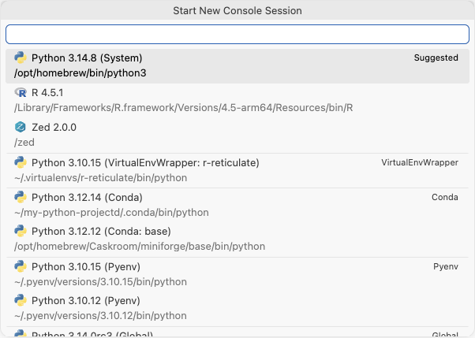
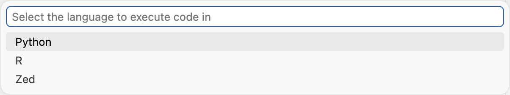

# Preferred language order

Issue: https://github.com/posit-dev/positron/issues/15999

**Summary:** Add a setting that controls the order of languages in the session and
language pickers and on the Welcome page. Today Python always comes first. The setting
lists every installed language, alphabetical by default, and you drag them into the order
you want. Leaving it alone keeps today's order.

## What I'd like feedback on

Leave comments inline on the lines they're about. These are the open decisions:

1. **Name.** `interpreters.languageOrder` puts it in the Interpreters group of the
   Settings editor, where users already go. Something like `languages.order` would fit
   better if we later extend it beyond pickers (Julia's whole-IDE comment on the issue),
   but it starts a new namespace.
2. **Carrying a patch to the list widget.** Reordering needs changes to VS Code's
   Settings editor list widget (see "List widget changes"). The drag fix is one line and
   is already up upstream. The handle and arrows are bigger, and we'd likely carry them
   for good.
3. **Languages installed after you reorder.** They go to the end of the order, but they
   don't appear as rows in the Settings editor until you add them (see "Edge cases"). I
   think that's acceptable.

## Problem

In the session picker, Python always comes before R. Nobody decided that; the picker sorts
alphabetically ("Python" < "R"). The first entry is pre-selected, so an R user has to
arrow past Python every time they start a session, and there's no way to change it. The
Welcome page environment setup rows have the same order, and we've had feedback asking
for R first there too.

## Proposal

Add one setting, `interpreters.languageOrder`: an ordered list of language IDs.

- By default it lists every installed language in alphabetical order, so nobody sees a
  change unless they reorder it.
- You reorder by dragging a row or using the Move Up/Down buttons that appear on hover.
  Every installed language is already listed, so there's nothing to add.
- It only reorders. It never hides a language. Any installed language that isn't in the
  list goes after the listed ones, alphabetically.
- The list comes from the installed language extensions, so Julia or any other
  third-party language shows up without a Positron change.
- It's a normal setting, so you can also set it per project in `.vscode/settings.json`.
  For example, someone who mostly works in Python could put R first in their R package
  repo.
- It only changes display order. It doesn't change which interpreter starts automatically.

## Where users see it

Each of these is a list where the first entry is pre-selected, or a set of rows people
asked to have reordered. Screenshots show today's order. With R first, R moves ahead of
Python in each.

**1. Start Session picker.** R moves above Python in the Suggested list, and the R section
moves above the Python sections. Versions within a language keep their order.



One change covers every place this picker opens from:
- The top bar session button
- The Console's **+** button
- The notebook kernel picker (Positron Notebooks and legacy Jupyter notebooks)
- The Quarto kernel picker

**2. Execute Code in Console (Command Palette).** Its language prompt lists R first. Few
people use this one.



**3. Welcome page environment setup.** The language rows follow the same order. Hiding a
row is a separate setting, `welcomePage.environmentChecks`, and it stays as it is.

## Alternatives considered

**A single "preferred language" dropdown.** This was the first version of this doc. It's
simpler to build, but it only lets you pick one language to go first. A list handles
people with three or more languages (Julia users, for example), and with every language
listed by default it's no harder to use.

**Inferring the preference instead of adding a setting.** I looked for something Positron
already tracks that we could read the preference from. Nothing works across workspaces:

- The last-used interpreter (`positron.affiliatedRuntimeMetadata.v2.<lang>`) is stored per
  workspace.
- Project detection (`.Rproj`, `renv.lock`, `.venv`) is also per workspace, and it lives
  inside the language extensions.
- The active session's language changes constantly, so the order would jump around within
  a window.
- `interpreters.startupBehavior` per-language overrides are rarely set.

A global signal would mean new hidden state, such as a stored "last started language".
That would reorder the list for anyone who uses both languages, and they'd have no way to
see why or to pin an order. Inference could still come later as the fallback when the
setting is unset.

**Sorting by recent use.** I ruled this out for the same reason: the order would keep
changing.

## Implementation

### The setting

Registered next to `interpreters.startupBehavior` in
`src/vs/workbench/services/languageRuntime/common/languageRuntime.ts`:

```ts
const languageOrderSchema: IConfigurationPropertySchema = {
	type: 'array',
	items: { type: 'string', enum: [] },
	uniqueItems: true,
	default: [],
	description: localize(
		'positron.interpreters.languageOrder',
		"The order of languages when picking an interpreter or language."
	),
	tags: ['interpreterSettings'],
};
```

The values are language IDs, the same ones as `ILanguageRuntimeMetadata.languageId`. The
setting uses window scope (the default), so it can be set per workspace.

`uniqueItems` plus an `enum` is what makes the list work without an Add button: each row's
dropdown only offers languages that aren't already listed, and the Settings editor hides
Add once every allowed value is in the list (`getShowAddButtonList` in `settingsTree.ts`).

### Building the list from installed languages

Extensions that provide interpreters already declare their language in `package.json`
(`"languageRuntimes": [{ "languageId": "r" }]`). `RuntimeStartupService` reads that
extension point (`runtimeStartup.ts:97`) before any extension activates. An extension
point allows only one handler, and `RuntimeStartupService` already has it, so the service
exposes the result: a `languageIds` getter and an `onDidChangeLanguageIds` event. The list
should also include runtimes that an extension registers through the API without declaring
them, the same way `hasLanguageRuntimeProvider()` does.

When the list changes, we update two things:

1. **The allowed values.** Replace the contents of `items.enum` and call
   `notifyConfigurationSchemaUpdated`, the way `workbench.iconTheme` builds its options
   (`themeConfiguration.ts`). The Settings editor rebuilds its dropdowns on that event.
2. **The default.** Register the new alphabetical list with
   `registerDefaultConfigurations`, the way `remoteExplorer.ts:333` changes the default of
   `remote.autoForwardPortsSource`. Changing the schema's `default` field alone isn't
   enough, because `notifyConfigurationSchemaUpdated` doesn't update default values.

Display names come from `ILanguageService.getLanguageName(languageId)`.

### Shared ordering helper

New file `src/vs/workbench/services/languageRuntime/common/languageOrder.ts`:

```ts
export const LANGUAGE_ORDER_KEY = 'interpreters.languageOrder';

/** Languages in `order` first, in that order; the rest after, by name. */
export function compareLanguages(
	a: { languageId: string; languageName: string },
	b: { languageId: string; languageName: string },
	order: readonly string[],
): number
```

The function is pure. Callers read the setting with `configurationService.getValue` every
time they build a list, not once at construction, so a change shows up the next time a
picker opens.

### Call sites

| Surface | Today | Change |
|---|---|---|
| Start Session picker (all entry points) | `createInterpreterGroups` sorts by `languageName` (`languageRuntimeActions.ts:553`) | Sort with `compareLanguages`. This one change covers every entry point and both the Suggested and per-language sections. |
| Execute Code language prompt | `selectLanguage` sorts by label (`languageRuntimeActions.ts:200`) | Sort with `compareLanguages` |
| Welcome page environment rows | `EnvironmentHealthService.state` lists sources in registration order (`environmentHealthService.ts:201`) | Sort with `compareLanguages`, and fire the service's change event when the setting changes so the card repaints |

### List widget changes

The Settings editor renders array settings with VS Code's `ListSettingWidget`
(`src/vs/workbench/contrib/preferences/browser/settingsWidgets.ts`). Out of the box it's
rough for ordering, so we patch it, wrapped in `// --- Start Positron ---` markers:

- **Drag fix.** Dragging rows has been broken since 2021: `onListClick` cancels
  `pointerdown`, which also cancels the native drag. The fix skips that for draggable
  rows. It's up upstream as microsoft/vscode#342556 (issue #342555), and we drop our copy
  when it merges.
- **Drag handle and Move Up/Down.** A grip icon shows on hover so it's clear rows can be
  dragged, and Move Up/Down buttons sit next to Edit and Remove for keyboard users and
  anyone who doesn't think to drag. We carry these as a Positron patch. Once the drag
  fix is reviewed, I'll ask on that PR whether upstream would take them.
- **No row tooltip.** The "List item `r`" hover covers the buttons. The row keeps its
  `aria-label`.

The handle and arrows apply to every list setting, not just this one. That's the same
behavior upstream would get, and I don't see a reason to limit it.

### Edge cases

- **A language installed after you reorder.** Your saved list doesn't include it, so it
  goes at the end, after the languages you ordered. It doesn't appear as a row in the
  Settings editor, but the Add button comes back (there's now an allowed value that isn't
  listed), which hints that there's something new. Showing it as a row automatically
  would need a custom settings renderer.
- **A language you uninstall.** If it's in your saved list, `settings.json` shows a "value
  is not accepted" warning. Nothing breaks, because `compareLanguages` skips IDs that
  aren't installed.
- **Removing a row.** It drops back to the alphabetical tail. It doesn't hide the
  language.

## Testing

- **Vitest for `compareLanguages`.** Check the default order (alphabetical), R first, a
  language missing from the list (goes after, alphabetically), and an ID in the list that
  isn't installed (ignored).
- **Vitest for the list widget.** Pressing a draggable row doesn't call
  `preventDefault()`, and Move Up/Down fire a `move` change with the right indexes.
- **Manual.** Reorder the setting and check each surface above. Install and uninstall a
  language extension and confirm the list and default update. Reset the setting and
  confirm nothing changed.
- **No new e2e test.** The default order doesn't change, so existing picker and Welcome
  page e2e tests should still pass.

## Notes: places left out

These also show Python before R. I looked at each and decided not to change it.

- **New Folder from Template cards.** All four cards are visible at once and none is
  pre-selected, so order is only cosmetic. Moving them would also break muscle memory, and
  keeping Jupyter next to Python makes an R-first layout awkward.
- **File > New File menu.** The Python and R entries come from the extensions' menu
  contributions, so changing their order would be a separate extension change.
- **Console session dropdown, Sessions pane, "Running Interpreter Sessions".** These list
  running sessions by recent use or creation time, not by language, and that seems right.
- **`welcomePage.environmentChecks` options.** Building its options from installed
  languages too is a good follow-up, but it needs other work first so non-built-in
  languages can contribute to the environment setup card.
