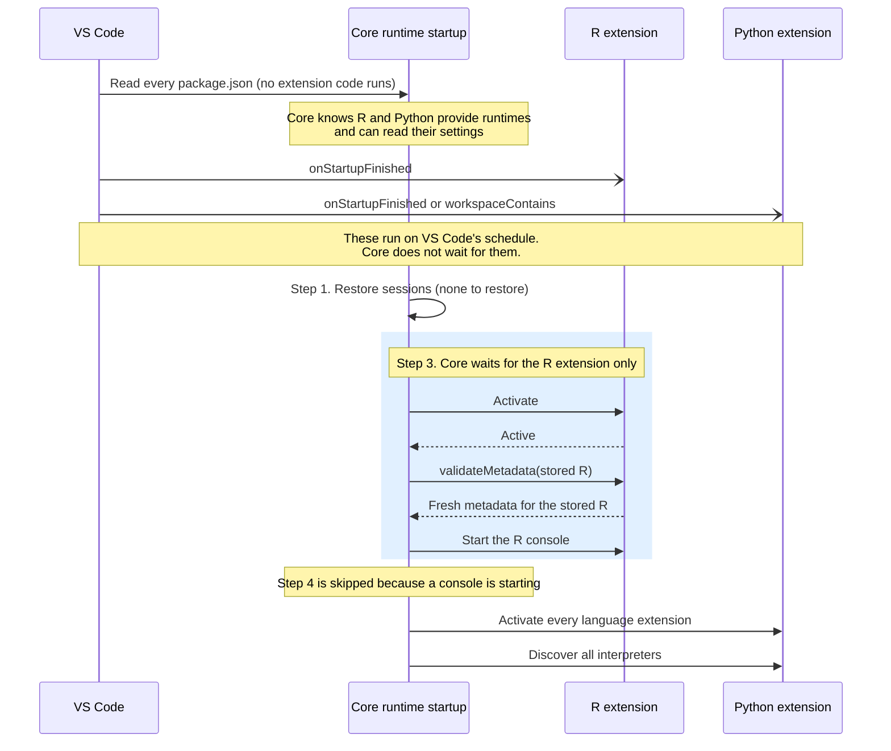
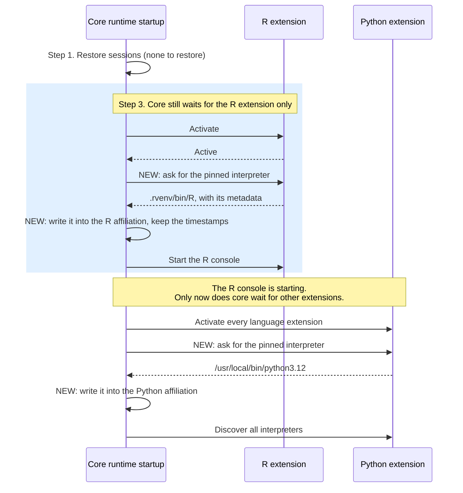
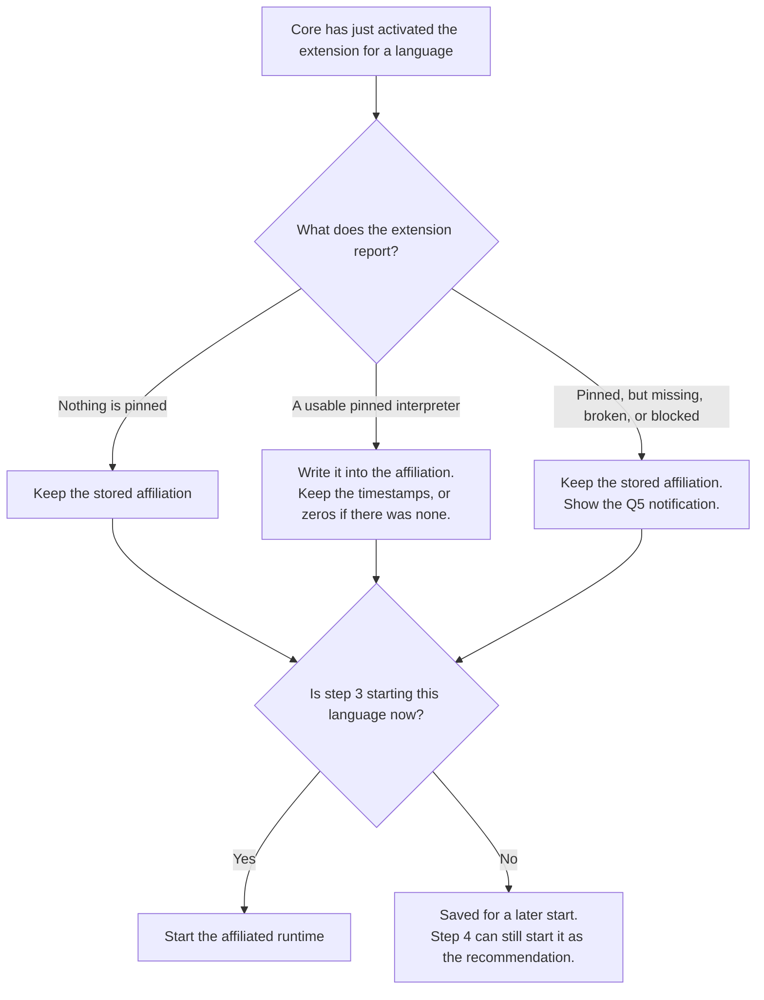

# Pinned interpreters and extension activation (Q19 and Q20)

Companion to [2659-pinned-interpreter.md](2659-pinned-interpreter.md). It explains how language extensions activate at startup today, then proposes where the pinned interpreter check goes so it meets the hard requirement.

## Proposal

Core asks a language's extension for its pinned interpreter right after core activates that extension, and never earlier.

- **Languages that step 3 starts.** Step 3 already activates the extension for each affiliated language just before starting its runtime. Core asks for the pinned interpreter at that moment, writes it into the affiliation, then starts it.
- **Every other language.** Core asks when it activates the rest of the extensions, in step 4 or discovery. Core already waits for every extension at that point today. This covers languages with no affiliation, affiliations that step 3 skips, and workspaces where a restored session means step 3 doesn't run.

So core never waits on an extension that it doesn't already wait on today. The knowledge of which setting pins an interpreter, and how to read it, stays in each extension.

## How extensions activate at startup today

### What core knows before any extension code runs

When the window opens, VS Code reads every extension's `package.json`. No extension code runs yet. From that, core already has:

| From `package.json` | What core learns | Where |
|---|---|---|
| `contributes.languageRuntimes` | Which extension provides runtimes for which language. Today it holds only a `languageId`. | `runtimeStartup.ts:95-110`, `433-448` |
| `contributes.configuration` | Every setting the extension declares. `getValue()` returns the resolved value (enforced, folder, workspace, user) before the extension activates. | `configurationExtensionPoint.ts` |

What core can't learn without the extension: what a setting value means (for example, `${workspaceFolder}` handling, or Python treating `python` as unset), and the runtime metadata for a path (its version and runtime ID).

### What activates a language extension

| What activates it | When | Does core wait for it before the first console? |
|---|---|---|
| VS Code activation events in `package.json`. Both R and Python use `onStartupFinished`. Python also uses `workspaceContains:` for `.venv`, `pyproject.toml`, and others. | Soon after the window opens, on VS Code's own schedule. `onStartupFinished` fires once eager activations finish, or after 10 seconds (`extHostExtensionService.ts:720-741`). | No |
| Core, step 3: `activateById()` for the first affiliated language only (`runtimeStartup.ts:1919-1930`, `1976-2003`) | Just before core starts that runtime | **Yes. When step 3 starts a console, this is the only wait before it.** |
| Core, step 4 and discovery: every language's extension (`runtimeStartup.ts:1800`, `1018`) | After step 3 | Not when step 3 started a console. With no affiliated runtime, step 4 waits for all of them, as it does today. |

So Python may already be activating on its own while R starts. The requirement isn't "Python must not activate". It's "core must not wait for Python before the first R console starts." In the #12645 timings, the Python extension finished activating 7 ms after core asked for it, which suggests it was already active.

### Today's startup, for a workspace with an affiliated R

## Where the pinned interpreter check goes

Steps 2 and 3 from the plan merge for each affiliated language: core asks for the pinned interpreter inside step 3, right after the activation that step 3 already does.

### Proposed startup, for a workspace with an affiliated R that is pinned

The Python write follows the plan's existing rules: keep the timestamps if Python has an affiliation, or write zeros if it has none. Either way it decides which Python starts next time, not whether one starts now.

### What core does with each answer

### Cost before the first console

One extra call into the extension host for the first affiliated language. What the extension does in that call:

- **R** reads the setting and a few files, including the conda and pixi check from Q10. It starts no other process. Milliseconds.
- **Python** reads the setting and resolves the path through its environment locator. That's slow, but it replaces work that already happens. Today core calls `validateMetadata()` on the stored Python before starting it, and that resolves the stored path the same way (`manager.ts:640-655`). Core registers the metadata the extension returns, and a registered runtime skips `validateMetadata()` (`runtimeSession.ts:1890-1894`). So the first console waits for one path resolution, as it does today.

Other affiliated languages start in the background after the first one, as today. Core asks each of them right after its background activation, so they never hold up the first console.

When the pinned interpreter fails, the extension reports it in its answer before core touches the affiliation. Core starts the stored affiliation as usual. The Q20 problem, where a `validateMetadata()` failure stops the rest of startup, doesn't arise for a pinned interpreter. This failure case does cost a second lookup: the failed pinned path, then `validateMetadata()` on the stored runtime.

## Options considered

| Option | How core learns about a pinned interpreter | Meets the requirement? | Main cost |
|---|---|---|---|
| **A. Ask after activation (proposed)** | New optional method on the runtime manager, such as `pinnedWorkspaceRuntime()`. Core calls it only for an extension it has just activated. | Yes. Core waits on nothing new. | New API surface. One extra call per language. |
| B. Declare the setting in `package.json` | `languageRuntimes` gains a field naming the setting. Core reads the value itself. | Yes | Core copies each extension's rules for reading the value. Core still can't build metadata, so `validateMetadata()` in both extensions must accept a bare path. |
| C. `validateMetadata()` swaps in the pinned runtime | No core change. Each extension's `validateMetadata()` returns the pinned runtime instead of the stored one, the way R handles "current R" today (`runtime-manager.ts:366-383`). | Yes | See below. |
| D. The extension pushes it | When the extension activates, it tells core to write the pinned runtime into the affiliation. #12116 suggested an API like this for a different bug. | Only by luck | The extension activates on VS Code's schedule, so the write may land before or after step 3 reads the affiliation. Core can't count on it without waiting. |
| E. Activate every extension first, then ask | Ask each extension before step 3 | No | Undoes #12645 |

### Why A over C

C is the closest to how startup works today, and it needs no new API. Its gaps all come from `validateMetadata()` only running when an unregistered stored runtime is about to start (`runtimeSession.ts:1890-1894`):

- **When nothing starts, nothing changes.** Under `manual` or `recommended`, after a restored session, or for an affiliation that step 3 skips, `validateMetadata()` never runs. The affiliation keeps the old runtime, so `getPreferredRuntime()` and the "Start R" button use it.
- **Some start paths skip it.** `onDidRegisterRuntime` starts an affiliated runtime that discovery has just registered, without validating it (`runtimeStartup.ts:1616-1650`). The pinned interpreter would be skipped without notice.
- **Core can't see it.** Core never learns that a runtime was pinned, so the Q5 notification and the start reason need a side channel.

A asks at the same moment C would, inside step 3 right before the start. It also asks during step 4 or discovery for every other language, which closes the first two gaps. And core gets the answer directly, which closes the third.

### Why A over B

B moves each language's rules for reading the value into core: `${workspaceFolder}` handling, and Python treating `python` as unset. It still needs an extension change, because only the extension can build the metadata. All it saves is one call into an extension that's already active.

## How this fits the way startup is built today

Jonathan built today's startup around a few ideas. A follows each one.

| Earlier design | What A does |
|---|---|
| At startup, activate only the extension that owns the runtime about to start. Discover everything else later. (#1067, #12645) | Asks only that extension before the first console |
| A stored affiliation is a hint. The owning extension checks it and corrects it right before the start. (#2316, #2535) | Asks at the same moment, and the extension returns fresh metadata |
| The language extension decides which runtime a workspace should use. Core stays generic. (#72, #2535) | The setting name and its reading rules stay in the extension |
| Run startup steps in a fixed order instead of in parallel. (#12645) | Asks at fixed points in the sequence, not whenever an extension happens to activate |

## Open questions

The questions for Jonathan are in Q19 of [the plan](2659-pinned-interpreter.md).
