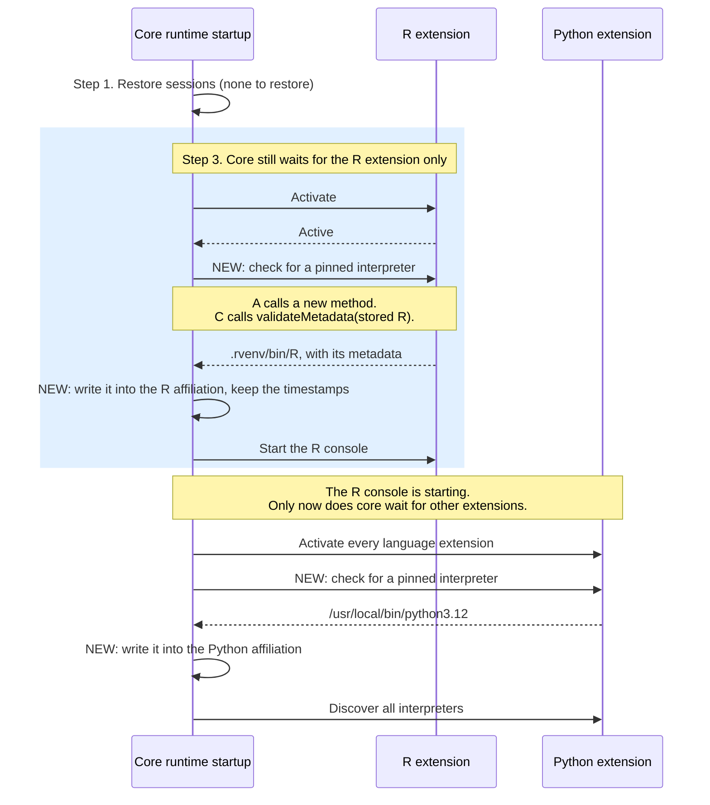

# Pinned interpreters and extension activation (Q19 and Q20)

Companion to [2659-pinned-interpreter.md](2659-pinned-interpreter.md).

**Short version:**

- At startup, only one extension activation holds up the first console. Step 3 activates the extension for the language it's about to start, and waits for it.
- So core can check for a pinned interpreter right after it activates an extension, and never earlier. The first console waits on nothing new.
- Two ways to do the check are left: a new method (A), or the existing `validateMetadata()` (C). C needs four small fixes. Q19 asks Jonathan to pick.

## What activates a language extension

| Who activates it | When | Does the first console wait for it? |
|---|---|---|
| **VS Code**, from the extension's activation events (conditions in its `package.json` that tell VS Code when to load it). R and Python both use `onStartupFinished`. Python also activates when the folder has a `.venv`, `pyproject.toml`, or similar file. | Soon after the window opens, on VS Code's schedule | No |
| **Core, in step 3**, for the first affiliated language only (`runtimeStartup.ts:1919-1930`) | Right before it starts that language's console | Yes. This is the only wait. |
| **Core, in step 4 and discovery**, for every language (`runtimeStartup.ts:1800`, `1018`) | After step 3 | No, if step 3 started a console |

So the requirement isn't "Python must not activate." It's "the first R console must not wait for Python."

## Startup with a pinned R

## A and C

| | A. A new method | C. `validateMetadata()` swaps in the pinned runtime |
|---|---|---|
| How it works | A new optional method on the runtime manager returns the pinned runtime, or the pinned path and why it failed. | Each extension's `validateMetadata()` returns the pinned runtime instead of the stored one, the way R swaps in "current R" today (`runtime-manager.ts:372-381`). |
| New API | One optional method | None, or one optional metadata field (C4) |
| New calls before the first console | One. When an interpreter is pinned, it replaces the `validateMetadata()` lookup. | None |
| Failed pinned interpreter (Q5) | Core shows the notification | Each extension shows its own |
| Fits today's design | Adds a check at a fixed point in startup | Reuses the "current R" pattern. R's code for it already links to #2659. |

C's gaps come from one fact: `validateMetadata()` only runs right before core starts a stored runtime that isn't registered yet (`runtimeSession.ts:1890-1894`). Each gap has a fix:

- **C1. Languages core doesn't start.** Under `manual`, after a restored session, or when step 3 skips a language, nothing updates the affiliation. The "Start" button then uses the old runtime. Fix: after step 4 or discovery activates an extension, core calls `validateMetadata()` on that language's affiliation and saves the result. This runs `validateMetadata()` when nothing is about to start, which it never does today.
- **C2. Languages with no affiliation.** There's nothing to validate. If another language starts first, step 4 is skipped, and the pinned interpreter is never recorded. Fix: core still asks those languages for their recommendation, and handles it the way step 4 would. This also applies to guesses, such as a `.venv`.
- **C3. The discovery start path.** `onDidRegisterRuntime` starts the stored affiliation without validating it (`runtimeStartup.ts:1616-1650`). Fix: C1 finishes before discovery registers that language's runtimes. A needs the same order.
- **C4. Core never learns that a runtime was pinned.** Fix: each extension shows the Q5 notification itself. An optional `pinnedBy` field on the metadata gives core the start reason. Without a "pinned" start reason, C needs no API change at all.

## Ruled out

- **B. Core reads the setting itself.** Core can read extension settings before activation. But it would copy each language's rules for reading the value, and it still needs the extension to build the metadata.
- **D. The extension pushes the pinned runtime when it activates.** It activates on VS Code's schedule, so the write may land after step 3 reads the affiliation.
- **E. Activate every extension first.** This breaks the hard requirement and undoes #12645.
