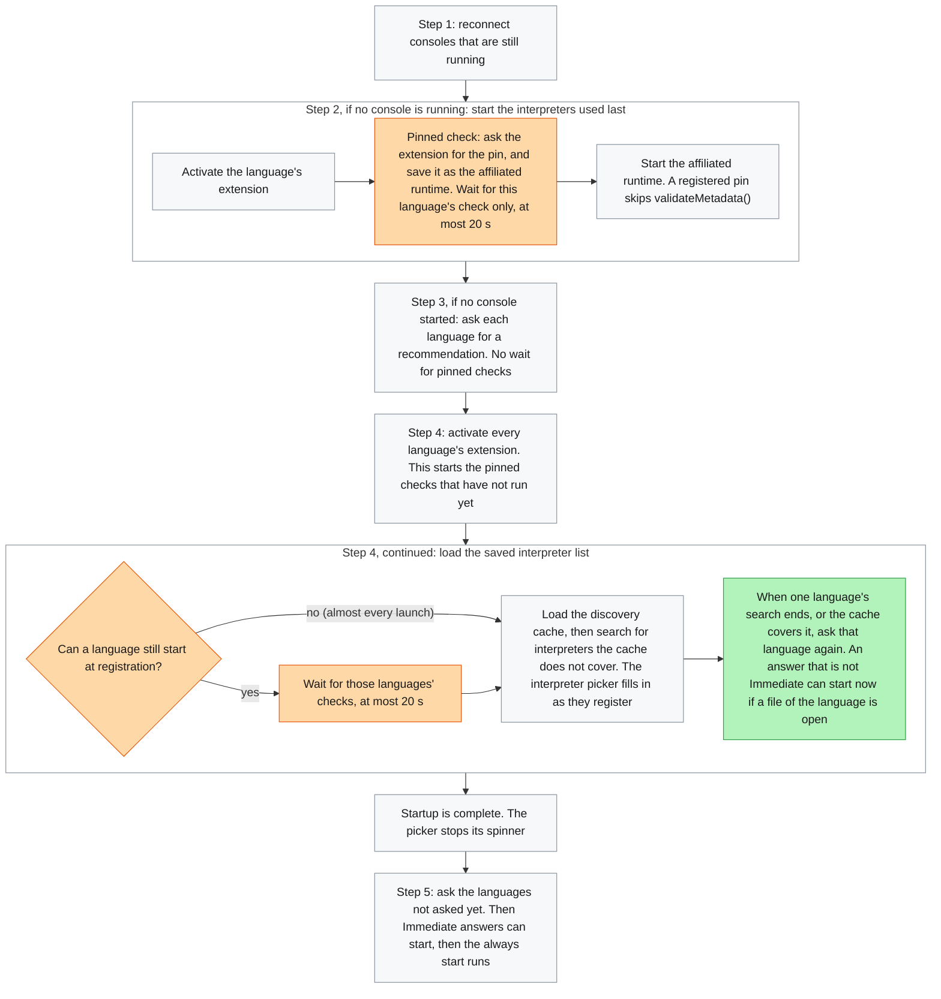
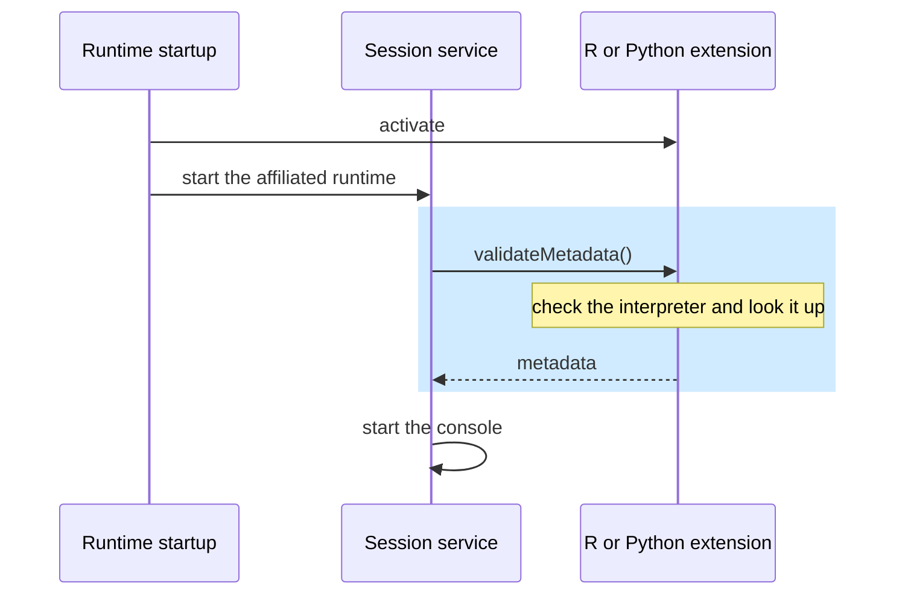
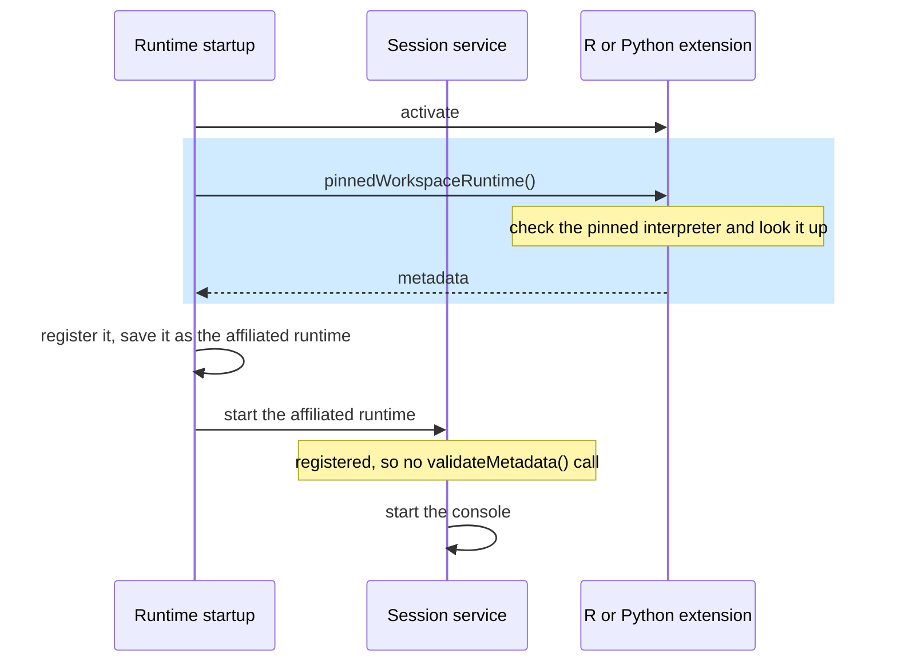

# How pinned interpreters work (#2659)

This doc describes pinned interpreters as built in the PR stack for #2659. The decisions behind them are in `plans/2659-pinned-interpreter.md`. The Q numbers below refer to that doc.

| PR | Part |
|---|---|
| #16849 | Core: the pinned check, its time limit, the start reason |
| #16850 | R: R's pin, R's recommendation, symlinks, r-versions |
| #16838 | Python: Python's pin, the setting text, the E2E test |
| #16851 | R file open: discovered Rs become `Explicit`, and core asks each language as soon as its own search ends |

## Terms

| Term | Meaning |
|---|---|
| Pinned interpreter | The interpreter that `python.defaultInterpreterPath` or `positron.r.interpreters.default` names. User-facing text calls it the default interpreter. |
| Affiliated runtime | The interpreter saved for a folder and language, normally the one used last. Step 2 starts it. |
| Recommendation | The interpreter a language's extension suggests for the open folder. |
| Pinned check | The new call that asks an extension for its pinned interpreter and writes it over the affiliated runtime. |
| `Implicit` | A startup behavior. Opening a file of the interpreter's language, or running its code, starts it. |
| `Explicit` | A startup behavior. Only a pick from the interpreter picker starts it. |

## What the pin does

The pin decides which interpreter starts in a folder. It does not decide the start time. `interpreters.startupBehavior` still decides that (Q3).

- **A folder with an affiliated runtime:** each time Positron opens the folder, the pinned check writes the pin over the affiliated runtime. So the pin starts in place of the one used last. If you pick another interpreter, your pick lasts until the next launch (Q2, Q4).
- **A folder without one:** the pin reaches startup as the language's recommendation. R's recommendation returns it, and Python's ranking puts it first, unless Positron was launched from a shell with an active Python environment.

## The startup sequence

Startup runs five steps. The pinned check runs inside steps 2 and 4, right after an extension activation that startup already does. It never activates an extension earlier than main does (#12645).

Orange: added by #16849. Green: added by #16851. Gray: as on main.

- A console in step 2 waits only for its own language's check. It never waits for another language.
- Steps 1, 3, and 5 never wait for a pinned check.
- Step 4 waits for a language's check in one case only. In that case, the old interpreter can start as the cache registers it. All four of these are true:
  - no console is in front
  - the language has no console
  - the language has an affiliated runtime
  - its startup behavior is `auto` or `always`
- On almost every launch a console is already in front, so the cache loads at once, as on main. The check still runs, so the pin becomes the preferred runtime for running code.
- The early ask in step 4 needs to know which languages each extension host searches. If core does not know, every language waits for step 5, as on main. Three cases cause this: the discovery cache is turned off, you run Discover All Interpreters, or an extension host does not list its languages.
- An `Immediate` answer still waits for step 5. Until every search ends, another language's affiliated runtime can still start as its search registers it. The answer must not start in front of it.

## How the pin starts in each step

| Step | Runs when | How the pin starts |
|---|---|---|
| 1: reconnect consoles | a console from the last window is still running | not on this launch. The check still saves the pin for the next launch |
| 2: start the interpreters used last | no console is running | the check saves the pin as the affiliated runtime, then step 2 starts it |
| 3: recommendations | no console started in steps 1 and 2 | R and Python recommend the pin. In a project of that language, it starts right away. In other folders, it waits until you run code or open a file |
| 4: saved interpreter list | every launch | not started here. Step 4 waits so that the old interpreter does not start in its place |
| 4, early ask, and 5 | the language has no recommendation yet | R and Python recommend the pin. An open file of that language starts it. Under `always`, step 5 starts it |
| After startup | you run code or open a file, and the language has no console | both start the preferred runtime: the affiliated runtime, else the one started last, else the recommendation |

- The pinned check only replaces an affiliated runtime that exists. It skips three cases (Q2, Q4, Q6, Q14):
  - A language with no affiliated runtime. The recommendation carries the pin.
  - A language under `recommended`. The recommendation carries the pin.
  - The interpreter that the New Folder flow just picked. That pick starts on the first launch, and the pin applies from the next one.
- The pin keeps the old interpreter's last-started and last-used times. So step 2 starts or skips the pin the same way it starts or skips the old interpreter.
- Under `definitionsOnly`, the check writes the first matching `interpreters.definitions` entry, the same rule a recommendation follows (Q10).
- If the pin fails a check, the extension returns nothing, and the old affiliated runtime starts as on main.

## R

- **The folder check.** In a folder that looks like an R project, a pinned R starts right away. In other folders, it starts once R is needed (Q13). R decides with the same folder search it already ran without a pin. The search takes up to 2 s, or about 4 s for an RStudio user in an empty folder. Under `manual`, R skips the search.
- **No saved recommendation.** R no longer asks core to save a recommendation that did not start as the affiliated runtime. Python already opts out. Without this, a pinned R in a folder with no R files starts on the second open.
- **The answer after discovery.** For a language with no recommendation yet, core asks again after discovery. R then answers with the pin. Without a pin, R answers with the R it lists first: the current R, otherwise the highest version. The answer comes from the Rs core already registered, so it never runs another search. Under `definitionsOnly`, R answers with the R from its first R definition, since R reports no pin in that mode.
- **Discovered Rs are `Explicit`.** Only R's recommendation and the pin are `Implicit`, as for Python. So on file open, no discovered R competes with the pin.
- **What R checks for the pin.** The path must exist. The R must be usable: not excluded, not outside `override`, and not too old. A missing path logs a warning.
- **Setup kept from discovery.** A pin in a conda or pixi environment starts with it activated (Q12). A pin that the r-versions file lists gets that entry's label, module, startup script, and library.
- **Paths.** A link to the current R, such as CRAN's `/usr/local/bin/R`, counts as the current R. On Windows, discovery lists R at `bin\x64\R.exe` where that file exists, and a pin at `bin\R.exe` maps to that path. In both cases the picker lists that R once.

## Python

- Python reads the setting with `get()`, so the folder value wins over the `.code-workspace` value (Q7). The default value `python` means no pin.
- It checks that the file exists, and applies `exclude`, `override`, and `definitionsOnly` (Q9).
- It looks up the one path, with Python's 15 s limit, and never starts a refresh of every interpreter. If the lookup misses or runs out of time, the old affiliated runtime starts for that launch.
- On Linux, a virtual environment or pyenv pin skips the wait for module discovery, because those can never be environment-module Pythons. That wait covers the whole interpreter scan.
- The pinned Python is `Implicit`, so opening a Python file starts it.

## Why the first console waits no longer than on main

Before a console starts, Positron checks that its interpreter still works. On main, that check is `validateMetadata()`. With a pin, the same checks run a moment earlier, inside the pinned check. So core skips `validateMetadata()` for the pin, and the console still waits for one check.

The session service calls `validateMetadata()` before it starts an interpreter that is not registered yet. In step 2 that is the usual case: the affiliated runtime comes from workspace storage, and step 4 has not registered anything yet. The saved copy can be out of date. The interpreter can be deleted, upgraded in place, or excluded by a setting. So `validateMetadata()` checks that the interpreter is still usable and returns fresh metadata.

The pinned check does the same checks and builds fresh metadata. Core registers the answer right away. A registered interpreter skips `validateMetadata()`.

| Extension | On main: `validateMetadata()` | With a pin: the pinned check |
|---|---|---|
| R | finds the current R, builds the installation from its files, rejects an R that is not usable | the same, after it checks that the pinned path exists |
| Python | file and exclude checks, one lookup (15 s limit), and on a miss a full refresh and a second lookup | file and exclude checks, one lookup (15 s limit), no refresh |
| Python on Linux | waits for module discovery | skips that wait for a virtual environment, conda, or pyenv pin |

The blue box marks the check in both diagrams.

On main:

With a pin:

With no pin set, the extension answers at once with nothing. Then the console starts through `validateMetadata()`, as on main.

## What waits for the pinned check

| What the user waits for | Waits for the pinned check | Added time |
|---|---|---|
| Reconnected console (step 1) | no | none |
| First console (step 2) | its own language only | none with a pin, a quick call with no pin |
| Other consoles in step 2 | each its own language only | same as the first console |
| Recommended console (step 3) | no | none, except for a pinned R (see below) |
| Interpreter list in the picker (step 4) | only in the rare case above: no console from steps 1 to 3 | none on almost every launch |
| End of startup | same as the interpreter list | same as the interpreter list |
| Answers after discovery (step 4 early ask, step 5) | no | none |

What still costs time:

- **A pinned R in step 3.** R's folder search takes up to 2 s, or up to 4 s for an RStudio user. Positron waits for every language's recommendation, so a Python console in step 3 also waits for it.
- **A pin that Python cannot find in time.** Python gives up after 15 s. Then the affiliated runtime starts and gets its check, as on main.
- **An extension that never answers.** Core stops waiting after 20 s and starts the affiliated runtime as saved. The check keeps running, so a late answer is saved for the next launch.
- **The rare step 4 wait.** With no console from steps 1 to 3, step 4 waits for at most 20 s.
- **One full search after the update.** #16851 raises the discovery cache version. So the first launch after the update searches for every language's interpreters, Python included.

## Known gaps

- With `always` set for all languages, at most one language starts. #16514 tracks the fix. Under `always`, an affiliated runtime you did not use last time also stays closed, as on main.
- A pin that starts through the recommendation shows the recommendation's start reason, not `pinnedRuntime`. That happens in a new folder and under `recommended`. Showing the pinned reason needs a new per-answer field in the recommendation API.
- With CRAN's R and no rig, an `interpreters.definitions` entry for `/usr/local/bin/R` stays unusable, as on main.
- With the discovery cache turned off, a file opened during discovery waits for every language before its interpreter starts.
- The session service's "first `Implicit` runtime" file-open start stays. No built-in language relies on it now, but third-party language extensions can.
