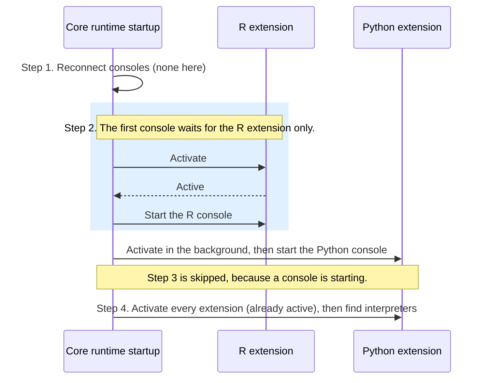

# How language extensions activate at startup today

- **What this is:** existing behavior only, read from `origin/main` at `03551d9f56`. Nothing here has been run unless it says so.
- **Step numbers** follow [interpreter-startup-today.md](interpreter-startup-today.md): 1 reconnect consoles, 2 start affiliated runtimes, 3 start recommendations, 4 find interpreters, 5 start after the search.
- **Why it matters:** a console can't start until the extension for its language is active. So which extensions core activates, and when, decides how long the first console waits. #2659's Q19 builds on this.

## Two things activate a language extension

| Who | How | Does core wait for it? |
|---|---|---|
| **VS Code** | From the activation events in the extension's `package.json` (conditions that tell VS Code when to load it). R and Python both list `onStartupFinished`. Python also activates when the folder contains `pyproject.toml`, `requirements.txt`, `setup.py`, `Pipfile`, `.venv`, `.conda`, and a few others, or when a Python file opens (`onLanguage:python`). | No. VS Code activates it on its own schedule. |
| **Core** | `activateExtension()` calls VS Code's `activateById()` with the event `onLanguageRuntime:<language>` (`runtimeStartup.ts:1983-2027`). If the extension is already activating, the call waits for that activation instead of starting another one. | Yes, at the points in the next table. |

## When core activates extensions

| Step | Which extensions core activates | Does the first console wait for it? |
|---|---|---|
| 1. Reconnect consoles | The extension for every console being reconnected, before core checks whether that console is still alive (`runtimeStartup.ts:2116-2120`, `2195-2197`). | Yes. A reconnected console is the first console. |
| 2. Start affiliated runtimes | Only the extension for the most recently used language that has an affiliated runtime. Core waits for it, then starts that console (`runtimeStartup.ts:1936-1937`). Each other affiliated language's extension activates in the background, and its console starts when it's ready (`1941-1945`). | Yes, but only for that one extension. |
| 3. Start recommendations | Every language's extension, except languages set to `disabled`. Core waits for all of them before it asks for recommendations (`runtimeStartup.ts:1807`). Step 3 only runs if no console started in steps 1 and 2. | Only in a folder with no affiliated runtime. Then the first console is a recommendation, and it waits for every extension. |
| 4. Find interpreters | Every language's extension, except `disabled` ones (`runtimeStartup.ts:1008-1018`). Most are already active from step 3. | No. A console has usually already started. |
| 5. Start after the search | None | No |

So the first console waits on:

- **After a window reload:** the extensions of the consoles being reconnected.
- **In a folder with an affiliated runtime:** one extension, the most recently used language's.
- **In a folder with no affiliated runtime:** every language's extension.

Step 2 activates only one extension so that an R console doesn't wait for Python to activate, or the reverse. #12645 added that.

## Example: a folder where R and Python both have an affiliated runtime

R was used most recently.

VS Code may also activate either extension through its own activation events. Core doesn't wait on those, and the two don't depend on each other:

- The extension host fires `onStartupFinished` once its eager activations finish (`*`, `workspaceContains`, remote resolvers), or after 10 seconds, whichever comes first (`extHostExtensionService.ts:696-718`). Python's `workspaceContains` events are part of those eager activations.
- Core starts step 2 once the language runtime contributions are registered and the folder is trusted (`runtimeStartup.ts:433-466`, `2437-2463`).

Nothing in the code orders one before the other, so which comes first depends on timing. Only a run would show it, for example by comparing the extension host's activation log with core's `extensionPreActivate` performance marks. It doesn't change what starts. If VS Code is already activating the extension, core's call waits for that activation instead of starting another one. It can only change how long step 2 waits.
